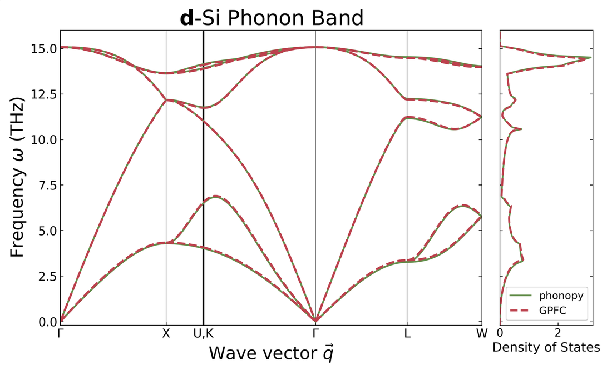
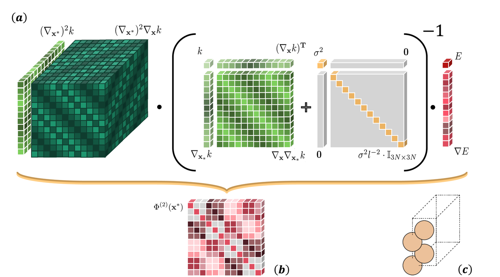
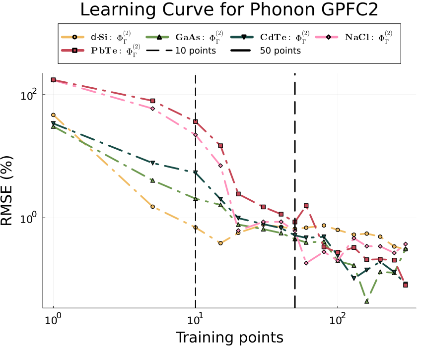
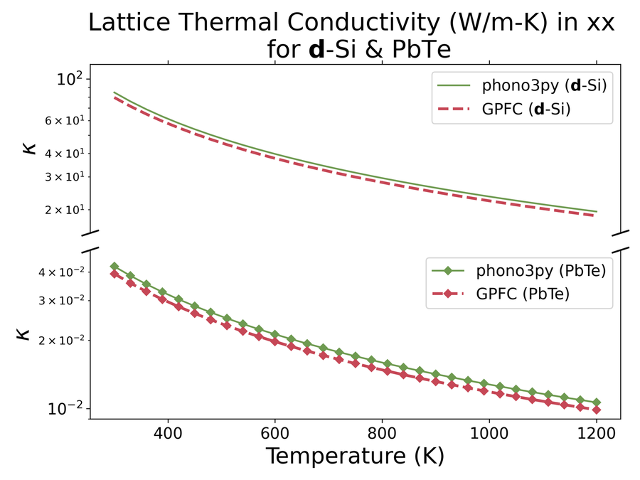

# GPFC.jl: Gaussian Process Force Constants

[](https://github.com/Frost-group/GPFC.jl/actions/workflows/CI.yml?query=branch%3Amain)
[](https://arxiv.org/abs/2405.05113)
[](LICENSE)

**Harmonic and anharmonic phonons from a handful of DFT calculations.**
GPFC.jl fits a Gaussian-process (GP) surrogate to the potential-energy surface of a crystal, trained on
energies *and* forces. Because a GP is infinitely differentiable, the second- and third-order force
constants are obtained by differentiating the trained model with automatic differentiation. You don't need a
finite-displacement supercell for every order.

<p align="center">
  
</p>
<p align="center"><sub>Diamond Si phonon bands and DOS: GPFC harmonic force constants (dashed red) against Phonopy finite displacements (solid green).</sub></p>

## Highlights

From [*Anharmonic phonons with Gaussian processes*](https://arxiv.org/abs/2405.05113), tested on five
materials (diamond Si, GaAs, CdTe, NaCl and PbTe):

- **Data-efficient.** Harmonic force constants converge once the number of training structures matches the number of
  degrees of freedom in the descriptor: **≈ 50** for a Cartesian 2×2×2 supercell (48 DOF), and only
  **≈ 6–10** with the phonon-coordinate descriptor.
- **Accurate.** Phonon band structures agree with Phonopy to an RMSE of **1–4 %**.
- **Anharmonic.** Third-order force constants need about **8×** the data of the harmonic ones, and the lattice thermal
  conductivity of Si and PbTe follows Phono3py from 300 K to 1200 K.
- **Scales well.** Predicting force constants appears to scale linearly with the number of atoms.

## How it works

The GP is trained on the energies $E$ and gradients $\nabla E$ of rattled structures $X$. Any derivative
of the predicted energy at the relaxed structure $\mathbf{x}^*$ is a contraction of a differentiated kernel with
the same trained weights:

$$
\Phi^{(n)}(\mathbf{x}^*) \;=\; \nabla^{n}_{\mathbf{x}^*}\, \mathbf{k}(\mathbf{x}^*, X)\,
\big[K(X,X) + \Sigma\big]^{-1}
\begin{bmatrix} E \\ \nabla E \end{bmatrix}
$$

$K$ holds the kernel and its first and second derivatives, $\Sigma$ is the energy/force noise, and
$\nabla^{n}$ is taken with [ForwardDiff](https://github.com/JuliaDiff/ForwardDiff.jl) and
[Zygote](https://github.com/FluxML/Zygote.jl): $n = 2$ gives the harmonic force constants and $n = 3$ the cubic ones.

<p align="center">
  
</p>
<p align="center"><sub>(a) The tensor contraction for one training point; (b) the resulting harmonic force constants Φ⁽²⁾ for (c) a 2×1×1 Si cell.</sub></p>

## Results

<table>
  <tr>
    <td width="50%"></td>
    <td width="50%"></td>
  </tr>
  <tr>
    <td><sub>Error in the harmonic force constants (phonon basis) against Phonopy, as a function of training structures. The error falls steeply over the first 10–20 structures for all five materials.</sub></td>
    <td><sub>Lattice thermal conductivity of Si and PbTe from GPFC cubic force constants (red) and Phono3py (green).</sub></td>
  </tr>
</table>

## Quick start

```julia
using Pkg
Pkg.add(url = "https://github.com/Frost-group/GPFC.jl")
Pkg.add("KernelFunctions")
```

```julia
using GPFC, KernelFunctions

# Kernel and noise hyperparameters
σₒ, l = 0.1, 0.4          # kernel scale, (inverse) length scale
σₑ, σₙ = 1e-5, 1e-6       # energy and force noise
kernel = σₒ^2 * SqExponentialKernel() ∘ ScaleTransform(l)

# 20 rattled structures of a 3-D crystal (column 1 is the relaxed structure)
equi, X, E, F, Target = ASEFeatureTarget("feature.csv", "energy.csv", "force.csv", 20, 3)

Kmm = Marginal(kernel, X, σₑ, σₙ)                                    # train
Φ₂  = PosteriorFC2(Kmm, Coveriance_fc2(kernel, X, equi), Target)    # harmonic, dim × dim
Φ₃  = PosteriorFC3(Kmm, Coveriance_fc3(kernel, X, equi), Target)    # cubic, dim × dim × dim
```

`feature.csv` and `force.csv` hold one structure per column (Cartesian displacements and forces), and
`energy.csv` one energy per row. Example datasets for Si, CsPbI₃ and an Au chain are in [`Dataset/`](Dataset/).
To read extxyz files with JuLIP instead, load `using JuLIP` and call `Read_JuLIP_Atoms`.

## Repository layout

| Path | Contents |
|---|---|
| `src/` | The package: kernel derivatives by AD (`Posterior.jl`), analytic RBF derivatives (`Analy_kernel.jl`), CSV loader (`csv.jl`) |
| `ext/` | Optional JuLIP extension for extxyz datasets |
| `test/` | Test suite on a bulk-Si dataset: analytic-vs-AD kernels, interpolation, force-constant symmetry |
| `Dataset/` | DFT energies and forces for Si, CsPbI₃ and an Au chain |
| `notebooks/` | Research notebooks per material (Si, GaAs, CdTe, NaCl, PbTe, CsPbI₃), dated by run |

## Citation

```bibtex
@misc{keeratikarn2024anharmonic,
  title         = {Anharmonic phonons with Gaussian processes},
  author        = {Keeratikarn, Keerati and Frost, Jarvist Moore},
  year          = {2024},
  eprint        = {2405.05113},
  archivePrefix = {arXiv},
  url           = {https://arxiv.org/abs/2405.05113}
}
```

## Authors

Developed by **[Keerati Keeratikarn](https://github.com/PKKeerati)** during a PhD at Imperial College London,
supervised by [Jarvist Moore Frost](https://github.com/jarvist) ([Frost group](https://github.com/Frost-group)).
MIT licence.
